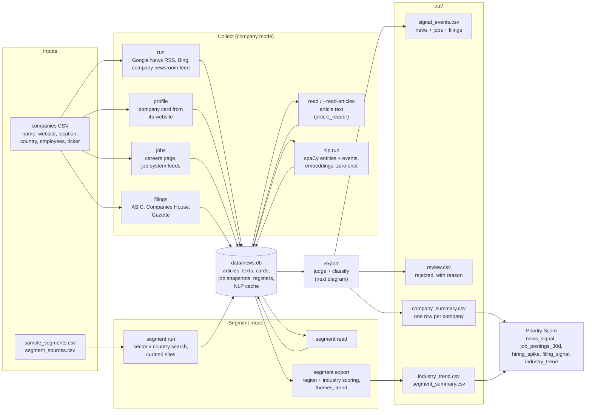
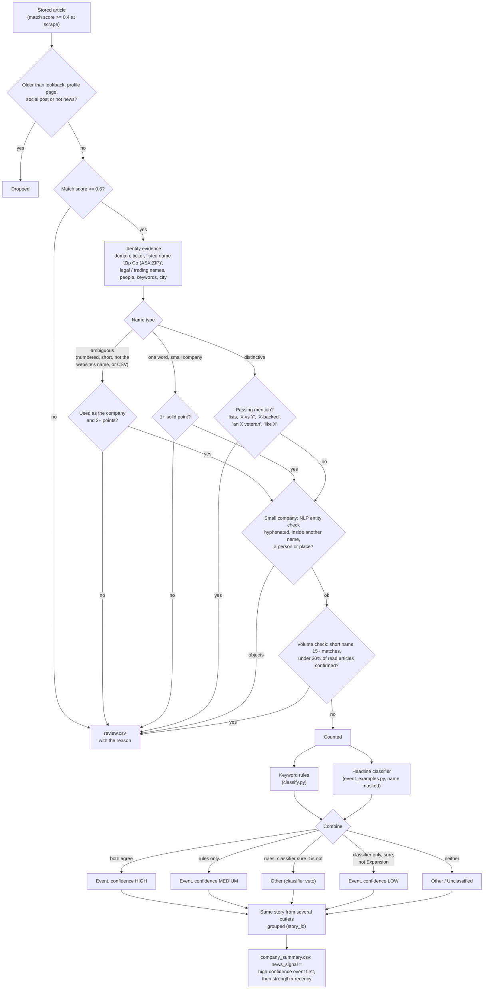

# News Scraper (proof of concept)

This tool finds recent news and turns it into inputs for Marketing Intelligence. It has two modes:

| Mode | Searches for | Produces |
|---|---|---|
| **Company mode** (`run`, `export`) | News about each company in a list | `news_signal` / `news_signal_date` for the Priority Score |
| **Segment mode** (`segment run`, `segment export`) | News about an **industry sector in a country**, e.g. Healthcare & Wellness × AU ([details below](#segment-mode-sector--country)) | A trend digest per segment, an `industry_trend` for the Priority Score, and a list of companies named in the news |

It is a zero-budget POC:

- Runs locally.
- Uses only free sources.
- Needs no new packages: it uses `requests` and `beautifulsoup4`, which are already in the repo's `.venv`.
- Stores everything in one SQLite file (`data/news.db`, shared by both modes).

This folder used to be `Marketing Intelligence/news_scraper/`. It reads the scoring settings from `../Marketing Intelligence/reference materials/data/` and the industry groups from `../references/mystaff_industry/`.

## How the data flows

Every command reads from and writes to the same SQLite file. `export` is the only step that decides anything: it re-judges every stored article each time, so rule changes apply without scraping again.



How one news article is judged and classified at `export`:



## Run it (from this folder)

```bash
../.venv/Scripts/python.exe -m news_scraper run --companies sample_companies.csv     # scrape
../.venv/Scripts/python.exe -m news_scraper export                                   # write out/*.csv
```

| Option | What it does |
|---|---|
| `--lookback-days 180` | **The lookback toggle.** How far back to look: 180 = 6 months (default). A `lookback_days` column in the CSV overrides it for one company. |
| `--mode auto` | Default. The first run for a company pulls the whole lookback window. After that, only new articles are fetched: since the last successful check, with a 2-day overlap. If you raise the lookback beyond what was already checked, it backfills again automatically. |
| `--mode backfill` | Always pull the whole window. |
| `--sources google,bing,newsroom` | Which sources to use (see below). Add `gdelt` to include it. |
| `--workers 6` | Companies processed in parallel. Each source still has its own rate limit, so adding workers does not make any source go faster. |
| `--limit N` | Only the first N companies, for testing. |

## Reading the full article (optional)

Reading full articles is handled by **`article_reader/`**, a separate package that turns a URL into clean article text. It does not import `news_scraper`, and `news_scraper` only loads it when reading is switched on.

```bash
# switched on during a scrape: reads the newest matched articles that have no text yet
../.venv/Scripts/python.exe -m news_scraper run --companies sample_companies.csv --read-articles [--read-max-per-company 10] [--read-min-match 0.6]
# or afterwards, for articles already scraped
../.venv/Scripts/python.exe -m news_scraper read [--max-per-company 10]
# or on its own, for any URL
../.venv/Scripts/python.exe -m article_reader https://example.com/some-article [--json]
```

**How it reads (free: `requests` + BeautifulSoup only)**

1. **Google News links** (`news.google.com/rss/articles/…`) are first turned into the publisher's real URL. This uses the same internal call the Google News page makes, so it is unofficial; if it fails, the read is recorded as `decode_failed`.
2. **`robots.txt` is respected.** Pages it disallows are recorded as `blocked_robots` and not fetched. Each publisher also gets its own polite rate limit.
3. **Text extraction** tries three methods in order:
   - the `articleBody` the publisher declares in its page data (JSON-LD)
   - otherwise, the `<article>` or the block with the most paragraph text, with menus, ads, share bars and so on removed
   - otherwise, the meta description, recorded as `too_short`
4. **Every result is stored with a status**, in the `article_texts` table: `ok`, `too_short` (paywall or JavaScript-only page), `http_error` (often a 403 from sites that block scripts), `blocked_robots`, `decode_failed`, `not_html` or `error`.
   - Failed reads are retried after 7 days.
   - Successful reads are never fetched again.

**What the text adds on export**

- **Classification:** if the headline alone says nothing specific ("Other"), the first 600 characters of the article decide the category.
- **A check on the match.** The article moves to `review.csv`, with the reason in the `check` column, if:
  - the text never names the company (or its domain), or
  - the company has `context` words and none appear, or
  - the article is not in English.

  On the test list, this caught "Rajasthan Deputy CM…" (for Deputy) and a Somali article where "xero" means "camp" (for Xero).
- **`signal_events.csv` gains three columns:** `text_status`, `check`, and `lead` (the article's opening ~300 characters).

**Results on the test list:** about 55–60% of articles were read in full, with a median of about 2,800 characters. Most failures are 403 errors from publishers that block automated requests, or paywalls. Articles that couldn't be read still count, just without the text-based checks.

**Speed:** decoding a Google News link takes 2 requests to Google at about 1 a second, so reading is limited to about 1 Google-sourced article every 2–3 seconds; other publishers are read in parallel. In daily mode only new articles are read, so 1,000 companies typically means a few hundred reads, about 15–30 minutes extra. Use `--read-max-per-company` to cap it.

**Copyright:** the text is kept only in the local database, to classify and check matches. Do not republish it. The CSV exports include only a ~300-character lead and the link.

## Input CSV

Only `company_name` is required.

| Column | Example | Used for |
|---|---|---|
| `company_name` | Culture Amp | The search. Legal suffixes (Pty Ltd, Inc…) are removed. |
| `website` | cultureamp.com | **Optional.** Finds the company's own news feed, and articles mentioning the domain count as a stronger match. Without it, matching uses the name and location only, and the summary says so. |
| `location`, `country` | Melbourne, AU | A matching hint. The country also sets the Google News region (AU, NZ, UK, US…). |
| `aliases` | CultureAmp;Culture Amp Pty Ltd | Other names, separated by `;`. Searched with OR. |
| `context` | software;rostering | **For company names that are common words** (Deputy, Orchard, Summit…). Added to the search so only articles that also mention one of these words come back. |
| `ticker` | ASX:XRO | Strong identity evidence when an article mentions it. Matched case-sensitively, so "TEAM" does not match "team". |
| `ambiguous` | yes / no | Whether the name is a common word. If blank, it is decided automatically (see [Common names found automatically](#common-names-found-automatically)). |
| `employees` (or `employee_count`) | 50 | Headcount. Companies under 1,000 staff without a ticker get the stricter checks for one-word names. Blank = treated as large. |
| `company_id` | your HubSpot or account ID | Keeps results linked to your records. If blank, an ID is made from the name and website. |
| `lookback_days` | 365 | Overrides the lookback for this company only. |

## Sources (all free)

| Source | How far back | Notes |
|---|---|---|
| `google` | 6+ months | Google News RSS search: the main source. It returns up to 100 results per query, so busy companies are searched month by month. It is not an official API, so keep the rate low (≈1 request a second). |
| `bing` | Recent only | Bing News RSS. It has no date filter, so it acts as a top-up for the latest news. |
| `newsroom` | Whatever the site publishes | The company's own RSS/Atom feed, found once from the website and re-checked every 30 days. Skipped when there is no website. On the test list, 2 of 7 websites had a feed. |
| `gdelt` | Last ~90 days | **Opt-in.** GDELT allows only one request at a time, 5+ seconds apart. From this network it returned "rate limited" even 12 seconds apart, so it is off by default. |

## Output (`out/`)

- **`company_summary.csv`**: one row per company, in the scoring's terms.
  - `news_signal` and `news_signal_date` come from the strongest event: category strength × recency, read from `Marketing Intelligence/reference materials/data/scoring_settings.json`.
  - `news_signal` blank = **not checked** (the score uses the baseline). `news_signal` "None" = **checked, found nothing** (a real zero). These are the two kinds of "empty" in the scoring model.
  - It also includes the headline and link, article counts, which sources worked, failed or were skipped, and a note when there is no website.
- **`signal_events.csv`**: every matched article, with category, strength, recency, match score and link.
- **`review.csv`**: possible matches (match score 0.4–0.6) to check by hand.

Articles are classified again on every export, so changes to the rules in `classify.py` apply without scraping again.

## NLP layer (`nlp.py`): is it this company, and what happened?

Free, CPU-only models on top of the keyword rules (dependency group `nlp`: spaCy, sentence-transformers, a small zero-shot model, SetFit). Install with `uv sync --group nlp`.

```bash
../.venv/Scripts/python.exe -m news_scraper nlp run   [--scope company|segment|all] [--stages entities,events,embed,zeroshot]
../.venv/Scripts/python.exe -m news_scraper nlp label --out out/labels.csv --n 200     # a sheet to label by hand
../.venv/Scripts/python.exe -m news_scraper nlp train --labels out/labels.csv          # after labelling
../.venv/Scripts/python.exe -m news_scraper export                                     # picks the results up
```

| Technique | What it does | Speed (laptop CPU) |
|---|---|---|
| **Entities** (spaCy) | Compares the company name with the entity that contains it. For **small companies only** it rejects: a hyphenated word ("Big Post-Launch"), another company's longer name ("Array Technologies"), or a one-word name tagged as a person or place ("Clancy", "Barga"). | 1.5 ms per headline, 24 ms per lead |
| **Events** (spaCy dependency parse) | The event, **who did it to whom** ("Shaw Gibbs acquires X" = acquirer; "Clermont acquired by Riveron" = target), the details (jobs and % cut, amount raised, place opened, executive title) and the certainty (reported, announced, possible, denied, completed). Shown in `nlp_event`, `nlp_role`, `nlp_certainty`. | same |
| **Embeddings** (MiniLM) | `fit`: how close the article is to the company's website description. `story_id` and `distinct_stories`: the same story from several outlets counts once (Canva's 22% layoff: 16 articles, one story). | 3.4 ms per story |
| **Zero-shot** (DeBERTa NLI) | Scores plain-English event descriptions against each story (`zs_label`, `zs_score`). Too noisy to set a category alone, so it only counts when the company is in the headline and the score is 0.75+. | about 3 s per story |

**What counts is deliberately conservative.** The extracted event replaces "Other / Unclassified" only with concrete detail and the company in the lead role: a job count or %, an office or a named place, an amount with a funding word, a named acquirer or target, an executive with a name. Everything else stays in the `nlp_event` column for review. Findings from spot checks that shaped this:
- An **organisation tag is not identity evidence**: spaCy tags "Clutch" (a hockey team, a video game) as an organisation, so it adds no points.
- **Well-known companies skip the entity rules.** spaCy tags Xero as a product and "Xero Limited" as a person, and "Canva Education" or "Xero Launches" are the company's own products. The first version rejected 312 real Xero and Canva articles; the final rules reject none.
- Rule-"Other" articles that the first version turned into events were wrong in roughly 8 of 11 cases, by reading the headlines ("expands partnership" is not an office; a share buyback is not a funding round; "named a Leader in Gartner" is not a leadership change).

**Scaling to more companies and sources:**
- Results are cached per story (`nlp_articles`, keyed by `dedupe_key` and a hash of the text), so each story is processed **once** however many companies or exports use it. It is re-processed only when its article text gets read later, or when `MODEL_VERSION` changes (events and entities recompute in seconds and keep the slow zero-shot and embedding results).
- Per 1,000 stories: entities and events 10 s, embeddings 25 s, zero-shot about 50 minutes. At 500 companies, expect 10,000 to 25,000 stories in the first run: about 4 minutes for everything except zero-shot, which is optional and is the step to skip or limit (`--stages entities,events,embed`).
- The first full zero-shot pass can be avoided by running it only on stories that survive the checks. With a GPU it is about 20 times faster.
- The same cache works for segment mode (`--scope segment`), and for any new news source, since every source feeds the same article tables.
- Memory is modest (about 1.5 GB with all models loaded); nothing is loaded unless that stage runs.

**Training from your labels.** `nlp label` writes a sheet of articles to label, picked where the signals disagree first: counted but the entity check objects, rules say "Other" but the NLP sees an event, rules and NLP disagree on the event, then a random sample that agrees. Fill in `about_company` (yes/no) and `category`. `nlp train` then:
- fits a **logistic combiner** for "about this company" over the evidence (identity points, entity verdict, mention count, fit, ambiguity…), reports cross-validated precision and recall and the weights it learned. Once saved it overrides the rules when confident (p ≥ 0.7 to let an article in, ≤ 0.3 to keep it out).
- trains a **SetFit** category classifier when every category has 8+ labelled examples, and applies it to articles still left as "Other".

Models are saved to `data/models/`. Delete the files there to go back to rules only.

**Measured against 177 articles labelled by Claude** (`out/labels_sample_companies_claude.csv`, `out/labels_small_companies_claude.csv`; one labeller, from the headline and lead, no second opinion, and sampled where the signals disagree, so treat as a first read, not ground truth):
- **Counted articles:** 127 of 137 were really about the company (93%). The 10 wrong ones were passing mentions of large brands ("Claude rolls out apps from Asana and Canva", "MC&V wins Canva work") and generic hiring blog posts from a company's site.
- **Review pile:** 0 of 40 rejected articles were actually about the company, so no false rejections in the sample.
- **Category:** the rules agreed with the labeller on 119 of 127 (most are "Other"). On the 17 articles with a real event the rules got 14; the NLP event got 7. NLP also found an "event" in 57 of the 110 articles the labeller called "Other". So `nlp_event` is useful for the details of an event the rules already found (job counts, amounts, roles), but not as a source of categories, which is why it is gated so tightly.
- **Learned combiner:** cross-validated precision 0.93, recall 0.96, against the rules' 0.93 and 1.00 on the same rows. No gain at this size, so no model is saved; retrain when there are 200+ labels with more mistakes in them.

### Event confidence (`event_examples.py`, `nlp.combine_event`)

A second classifier checks the keyword rules. It is a logistic regression over sentence embeddings (mpnet, 12 ms per headline), trained only on the example headlines written in `event_examples.py`, with the company name replaced by "Acme" so it reads the event, not the brand. It needs no labelled articles, and it runs at export on counted news articles (cached per article in `nlp_event_probs`).

Each can overrule the other when sure, and every event gets an `event_confidence`:

| Confidence | Meaning | Right on the build set | Right on 12 unseen companies |
|---|---|---|---|
| `high` | Rules and classifier agree | 60 of 61 | 16 of 18 |
| `medium` | Rules say event, the classifier is not sure (or overrules the category) | 7 of 14 | 2 of 9 |
| `low` | Classifier only (never for Expansion, which failed on unseen companies) | 9 of 10 | 3 of 5 |

- `category_basis` says where the category came from: `rules`, `classifier`, `classifier veto` (the rules matched a word, the headline is about something else), `nlp event`, `zero-shot`.
- `company_summary.csv` picks a **high-confidence event first** for `news_signal`, and shows `signal_confidence`. For scoring, treat `high` as reliable and `medium` / `low` as leads to check.
- To teach it a missed phrasing, add an example line to `event_examples.py` (e.g. "{Co} wins banking licence in {City}" under Expansion). The model retrains itself on the next export.

**Measured** (`eval/eval_events.py`, labels in `eval/gold_events.csv`, 865 distinct stories labelled by Claude from the headline):

| | Rules alone | Rules + classifier |
|---|---|---|
| Build set (672 stories, 95 events; flattered by 61 Canva layoff stories) | precision 0.85, recall 0.67 | 0.88, 0.80 |
| **Holdout: 12 companies never used for development** (193 stories, 38 events) | precision 0.60, recall 0.47 | 0.66, 0.55 |

The holdout is the honest estimate: about two in three events are right and about half are found, from headlines alone. The `high` tier is the part that holds up (about 9 in 10). Re-run the script after any change to the rules or examples, and add or correct rows in the CSV.

**Tried and dropped** (each measured on the labelled sets):
- **Grammar role of the name** (subject vs modifier) to catch passing mentions: every rule rejected 2 to 4 real articles per passing mention caught, because "Canva layoffs" and "Canva couple" have the same grammar.
- **Embedding classifier for passing mentions:** caught 15 of 51 and wrongly rejected 13.
- **Training on the real labels as well:** worse across companies than the written examples alone (the labels are mostly one company's layoffs).
- **Requiring the company to be the grammatical actor of the event:** lost real layoffs ("A.I. Wave Hits Canva as Design Giant Cuts 1,000 Jobs").
- What did work for passing mentions is a short list of safe phrases (`Matcher.passing_lexical`): "X-backed", "an X veteran", "like X", "the X tower". It removed 21 of 51 with no real article lost. About 30 in 672 remain (precision 0.954).

**Name-matching fixes found on the holdout:**
- "Zip Co (ASX:ZIP)", the exact name followed by an exchange ticker, now counts as strong evidence (`listed-company name`).
- The volume check only judges articles whose text was read; with headlines alone nothing could confirm a company (Tyro Payments went from 0 to 21 real matches).
- For a one-word name, a single generic website keyword is not confirmation ("designed" confirmed Kid Koala).
- **Read the article text for small or common names** (`run --read-articles`): Zip Co went from 0 to 24 matches once text was read. A name that is also an everyday word in its own country ("Koala" in Australia) still needs `ambiguous` = yes or `context` words in the CSV.

**Not done yet:** segment export does not read the NLP results yet (they are computed with `--scope segment`), and the SetFit and about-company models are not trained.

## Job signals and filings

Two more commands add non-news signals for the same companies. `export` merges everything into `signal_events.csv`, with a `signal_type` column: `news`, `jobs` or `filing`. `news_signal` in `company_summary.csv` still comes from news only, so its meaning in the score doesn't change. Jobs and filings get their own columns.

```bash
../.venv/Scripts/python.exe -m news_scraper jobs    --companies companies.csv            # AU, UK, US alike
../.venv/Scripts/python.exe -m news_scraper filings --companies companies.csv [--registers au,uk]
../.venv/Scripts/python.exe -m news_scraper export
```

All sources are free and need no API key. The CSV can also have an `employees` (or `employee_count`) column; see the input table.

### Jobs (`jobs.py`)

For each company with a website (robots.txt respected):
1. **Find the careers page**: a "Careers", "Jobs" or "Join us" link on the home page, else a common path (`/careers`, `/jobs`…), plus one "View open roles" link from there.
2. **Read a job system's public feed** if the page uses one: Greenhouse, Lever, Ashby, Workable, SmartRecruiters, BambooHR, Recruitee or Personio. This gives every open role with title, department, city and usually the date posted.
3. **Otherwise read `JobPosting` data**, the structured data Google for Jobs uses, from the careers page and up to 25 job pages it links to.

Job systems without a public feed (JobAdder, Employment Hero, Workday, PageUp…) and job boards (SEEK, Indeed, LinkedIn) are recorded in `jobs_method` as `seen: …` but not read.

| `company_summary.csv` column | Meaning |
|---|---|
| `jobs_status` | `ok`, `no roles found` (careers page found, no feed or data, often a list built with JavaScript), `not readable`, `no careers page`, `no website`, `error: …` |
| `open_roles` | Roles listed now (only when `ok`) |
| `job_postings_30d` | The score's field: roles posted in the last 30 days when the feed gives dates (`jobs_dates_known` = yes), else all open roles. **Blank when unknown.** `no roles found` is not a zero, because the page may load its list with JavaScript. |
| `hiring_spike` | `Yes` when open roles are at least 1.5× **and** 3 more than a snapshot taken 21–120 days earlier. Blank until there is an earlier snapshot, so the first run never shows one. |

Each run stores a snapshot (`job_snapshots`) and every role seen (`job_postings`). `signal_events.csv` gets one row per company: `Hiring`, `Hiring spike` or `No open roles`.

### Filings (`registers.py`)

| Country | Source | What it gives |
|---|---|---|
| AU | ASIC Company Dataset (data.gov.au, monthly zip) | Legal name, ACN, ABN, status (registered, external administration, strike-off, deregistered), registration date, **former names with the date of each change** |
| AU | ASIC Business Names Dataset (monthly zip) | **Trading names** registered to the company's ABN, with dates |
| UK | Companies House Free Company Data Product (monthly, 7 zips) | Status, incorporation date, SIC codes, accounts category and date, previous names with dates |
| UK | The Gazette insolvency notices (searched per company) | Winding-up, administration and liquidator notices |
| US | Not covered | SEC EDGAR needs a contact email in every request. It can be added later. |

The downloads (about 150 MB for AU, 470 MB for UK) are cached in `data/registers/` and replaced when the next monthly file comes out.

**Matching.** Company names are unique in both registers, so an exact legal-name match is the company. Names are compared after normalising ("Pty. Ltd." = "Proprietary Limited" = "PTY LTD", "&" = "and").
- The ACN is read from names like "A.C.N. 633 889 433 Pty Ltd".
- A name without a legal suffix ("Atkar") is also tried with "Pty Ltd" or "Ltd", and as a registered business name. A business name gives the ABN, and so the company.
- When the same name belongs to several records (e.g. an old deregistered company), the current, registered one wins.

The country comes from the `country` column, else the website (.au / .uk).

**Events** in `signal_events.csv` (`signal_type` = filing), within the lookback:

| Category | When |
|---|---|
| Insolvency / administration | ASIC status "external administration", a Companies House status of liquidation, administration or receivership, or a Gazette insolvency notice |
| Strike-off / deregistered | Struck off, dissolved or deregistered (or a strike-off in progress) |
| Name change | A former name with a change date in the lookback |
| New trading name | A business name registered to the ABN in the lookback |
| Newly registered | The company itself registered in the lookback |

`company_summary.csv` gets:
- `filing_signal`, `filing_signal_date`: the most severe recent event, in the order of the table above. "None" = found in the register, nothing recent.
- `registered_name`, `registration_id` (ACN or company number), `abn`, `registered_status`, `registered_on`, `trading_names`, and for the UK `uk_accounts` and `uk_sic`.

**Better news matching too.** The registered and trading names are added to the identity evidence used to confirm news matches, the same as names found on the company's website. "Caesars" in an article now confirms Barga Pty Ltd.

## Company card (`profile.py`)

Each company with a website gets a card, built from its home page and About page and rebuilt every 30 days. It holds:
- the site name, legal name and alternative names (e.g. SafetyCulture's site now says "Mitti")
- the ticker, founders and city, from the structured page data (JSON-LD) when the site provides it
- up to 12 keywords and short phrases from the page title and description (e.g. Deputy: "employee scheduling", "payroll software", "labor forecasting")

The card is built automatically during `run`. To see what was found:

```bash
../.venv/Scripts/python.exe -m news_scraper profile --companies sample_companies.csv [--refresh]
```

## Does an article count? (`match.py`, applied at export)

Each article collects **identity evidence**: points for signs that it means *this* company.

| Evidence | Points |
|---|---|
| Website domain, ticker, legal or alternative name, founder or executive | 2 |
| A `context` word (chosen by a person) | 2 |
| A card keyword phrase | 1 each |
| Card single words | 1 in total |
| City or country | 1 |

**2 points confirm the company.** What else is required depends on the name and on whether the article text was read:

| | Article text read | Text not read (stricter) |
|---|---|---|
| **Ambiguous name** (Deputy) | Named as the company, not as a title ("Deputy Mayor") or ordinary word ("deputy"), **and** 2+ points in the text | Named as the company in the headline, **and** 2+ points in the headline and summary |
| **Distinctive name** (Atlassian) | Named in the text, written the company's way ("ROKT" or "xero" don't count). A passing mention in the headline needs 2+ mentions in the text, or 2+ points | Named in the headline, written the company's way, and not a passing mention (lists like "Adobe, Canva, CapCut", comparisons like "X vs Canva", "Canva alternatives"), unless 2+ points confirm it |

Articles that fail go to `review.csv` with the reason in the `check` column. The `evidence` column shows what was found. Posts from social and video sites (YouTube, Instagram, LinkedIn…) never count.

### Common names found automatically

Nobody will mark 500 names by hand. When the `ambiguous` column is blank, a name is treated as ambiguous if:
- `context` words are given, or
- it is a **numbered company** ("12768640 CANADA INC.", "A.C.N. 633 889 433 Pty Ltd"), or
- it is **3 characters or fewer** once "Pty Ltd" etc. are removed ("ARG LLC"), or
- it is **one word that is not the website's name**: "Clancy" at clancycorp.com.au, "Array" at arraynetworks.com, "Barga" at caesars.net.au.

Two more checks apply only to **small companies** (`employees` under 1,000, no ticker), because famous brands get plenty of news whose headlines carry no domain or city:
- **One-word names need 1+ point** of evidence, even when the name is the website's: "Accora" (accora.care) otherwise collected tenant protests at Accora Village in Ottawa.
- **Volume check.** A one- or two-word name with 15+ news matches, fewer than 20% of them with any evidence, is judged again as ambiguous: "Clutch" (clutch.co) had 116 matches about sport and video games; "Big Post" had "Big Post-Launch Changes". Names of three or more words ("Bank of Sydney") are specific enough and are not re-checked.

`company_summary.csv` shows the reason in `name_type`, e.g. `ambiguous (one-word name that is not the website's name)`.

**On 100 Priority List companies** (180 days, article reading on): news matches fell from 577 to 42, and all 42 are about the right company (Bank of Sydney, City Chic, ClassLink…). On the 10 sample companies (Canva, Xero, Atlassian…) the counts are unchanged.

**On the 10 test companies:**
- **Deputy:** 35 unrelated articles moved to review ("Deputy Mayor", "deputy minister", "Deputy CM"…), with 1 real article lost.
- **Rokt:** 5 articles about an ETF with the ticker "ROKT" moved to review.
- **Distinctive names:** they kept 98% of their articles; only lists, comparisons and junk were removed.

## How it decides

- **The quick match score at scrape time** (`match.py`) decides what is stored. Each article gets a score from 0 to 1:
  - name in the headline: +0.6
  - name in the summary only: +0.4
  - website domain mentioned: +0.3
  - location or context word mentioned: +0.15
  - the company's own website: 1.0

  Ticker, legal name or a founder count like the domain (+0.3), and card keywords like location (+0.15). A score of 0.4 or more is stored; at export, an article also needs 0.6 or more, plus the identity checks above, to count.
- **What kind of news?** (`classify.py`) Keyword rules sort each article into the scoring categories: Funding round, PE buyout, M&A, Expansion / new office, Restructuring, Leadership change, otherwise "Other / Unclassified".
  - The rules exclude common false positives, such as "raises price target", "X-backed start-up raises", "stocks to buy" and "talent acquisition".
  - Company-profile pages (funding lists, stock charts) are dropped entirely.

## Results on the 10 sample companies (Nov 2026)

- **6-month backfill:** about 800 matched articles. Every company was found, and Google and Bing worked for all 10.
- **Daily update:** 10 companies in **16 seconds**, finding 31 new articles.
- **Correct examples:** the Canva layoffs and restructure, Airwallex's Series H, Culture Amp's job cuts, Airwallex's appointments, Octopus Energy entering the Irish market.

## Scale: 1,000+ companies a day

- **Daily update:** about 1 Google + 1 Bing query per company. At the polite rate of ≈1 request a second per source, run in parallel, that's about **25–30 minutes for 1,000 companies**.
- **First backfill:** most small companies need one Google query; busy ones need up to 7. That's roughly 1–2 hours for 1,000, done once.
- **Storage:** a few thousand articles a day in SQLite is no problem.
- **To schedule it locally,** use Windows Task Scheduler to run `run` then `export` every night.

## Known limits (Nov 2026)

1. **Most small companies have no news.** In the 100-company Priority List test (median 50 staff), 74 had nothing and only 7 had third-party news. News will be blank or "None" for most accounts; jobs and filings matter more for them.
2. **Event detection is moderate on unseen companies.** On the 12-company holdout, about 2 in 3 detected events are right and about half of real events are found, from headlines. The `high` confidence tier holds up (about 9 in 10); `medium` is close to a coin flip.
3. **Passing mentions of big brands** ("Canva couple sell home", "MC&V wins Canva work") still get through: about 30 in 672 stories. Telling them apart needs world knowledge the rules don't have.
4. **Legal names are not trading names.** Searching "Barga Pty Ltd" finds nothing about "Caesars Furniture". The registers and website cards already know the trading names, but they are used only as evidence, not as search terms.
5. **Job signals are thin.** Only 6 of 100 small companies had a readable role list; most post on SEEK, which has no free feed. 28 of 100 websites block automated requests.
6. **Labels are one labeller's.** Every precision and recall figure in this README is against labels Claude made from headlines. No person has checked them yet.
7. **Google News RSS is unofficial.** It can rate-limit or change format without notice. The coverage table records every failure, so a failed check never looks like "no news".

## Next steps

In order of value for effort. Each one has a way to measure it: re-run `eval/eval_events.py` (events) or the labelled sheets in `out/labels_*_claude.csv` (is it about the company).

**1. Make it safe and checkable (days)**
1. **Commit the work.** Nothing in this folder is committed yet, and `pipeline.py` was once truncated to zero bytes during editing and had to be rebuilt.
2. **Have a person check the labels.** Go through `eval/gold_events.csv`, holdout rows first (193), and correct any `about_company` or `category` you disagree with. Then add 100–200 rows from your own companies. Every number here depends on these labels.
3. **Turn the evaluation into tests.** A small `pytest` suite that fails if precision or recall on the labelled set drops, so rule changes can't silently make things worse.

**2. Feed the Priority Score (1–2 weeks)**
1. **Replace the mock fields in `format_priority_data.ipynb`** with the real outputs:
   - `news_signal`, `news_signal_date` from `company_summary.csv`. Use full strength for `signal_confidence = high` and a reduced strength (or the baseline) for `medium` / `low`, until labels show the medium tier is better than a coin flip.
   - `job_postings_30d`, `hiring_spike` from the jobs columns. Blank stays blank (unknown), not zero.
   - `industry_trend` from `industry_trend.csv` (closes BUSINESS_RULES gap A8).
   - A new **disqualifier or flag** for `filing_signal = Insolvency / administration` or `Strike-off / deregistered`. Callagher Estate Agents and Capital Tanks are on the Priority List today.
2. **Run the top 500 Priority List companies** with `--read-articles` (small and common names need the text), then `jobs`, `filings`, `nlp run --stages entities,events,embed` (skip zero-shot at this scale), and `export`.
3. **Schedule it nightly** with Windows Task Scheduler. Run `jobs` again after 21+ days so `hiring_spike` can be computed.

**3. Better matching and recall (2–3 weeks)**
1. **Search on trading names.** Add the registered business names (ASIC) and the website's own name (`profile.py`) to the search terms, not only the evidence. This is the biggest recall gain for small AU companies.
2. **Retry failed website profiles** with a slower, browser-like fetch. 28 of 100 sites blocked the first attempt, and the card is what confirms a match.
3. **Teach the classifier missed phrasings.** Add lines to `event_examples.py` for what the holdout missed: "wins banking licence in {City}" and "becomes {City}'s first digital bank" (Expansion), "in talks to lead a round for {Co}" (Funding). Check the holdout score doesn't drop.
4. **Use the NLP and classifier in segment mode.** Write theme examples the same way (`event_examples.py` style) and replace the two-hit text rule. "Other sector news" is still 68%.

**4. A judge for the hard cases (2–4 weeks, still free)**
1. **A local LLM** (Ollama with a 7–8B model) only for what the rules can't settle: `medium` and `low` events, and review rows that have some evidence. That is roughly 10–20% of articles, small enough for a laptop CPU.
2. **Give it the company card** (name, website, industry, city) and the headline plus lead. Ask for fixed JSON: about the company yes/no, event, the company's role, and a quoted reason.
3. **Measure it on the labelled set before trusting it**, against the current 0.954 precision on "about the company" and the holdout event scores. Keep it only where it beats the rules.

**5. More signal sources (as budget allows)**
1. **Jobs:** Adzuna API (free key) as a top-up to careers pages, since most small companies advertise on SEEK.
2. **US filings:** SEC EDGAR (free; needs a contact email in each request), including Form D for private fundraising.
3. **Paid trial:** Event Registry / NewsAPI.ai or PredictLeads on the same 100 companies, scored with the same labelled set. They do entity linking and event tagging out of the box and could replace much of the classification work, if they score better.
4. **Monitoring:** re-run the evaluation monthly. Sources and phrasing drift, and the coverage table already shows which sources fail.

---

## Segment mode (sector × country)

Company mode asks "what is happening at *this company*?". Segment mode asks "what is happening in **this industry in this country**?", e.g. *Accounting × UK* or *Healthcare & Wellness × AU*. One scrape serves three uses:

| Use | Output | For |
|---|---|---|
| **Market trend digest** | `segment_summary.csv` | Campaigns, content and sales talking points: the themes in each segment, volume, momentum and top headlines |
| **Priority Score tailwind** | `industry_trend.csv` | Replaces the mock `INDUSTRY_TREND` values (BUSINESS_RULES A8): a 0–1 `industry_trend` per industry group × country, and per group overall |
| **Prospect discovery** | `segment_companies.csv` | Companies named in the sector news, marked as existing account or not. The file can be fed straight into company mode |

### Run it

```bash
../.venv/Scripts/python.exe -m news_scraper segment list                                          # groups, countries, themes
../.venv/Scripts/python.exe -m news_scraper segment run --segments sample_segments.csv             # scrape
../.venv/Scripts/python.exe -m news_scraper segment run --groups all --countries AU,NZ,UK          # or: every group x these countries
../.venv/Scripts/python.exe -m news_scraper segment read --target uncertain --max-per-segment 0      # optional: article text, for better checks
../.venv/Scripts/python.exe -m news_scraper segment export                                         # write out/segment_*.csv, out/industry_trend.csv
../.venv/Scripts/python.exe -m news_scraper run --companies out/segment_companies.csv              # then: company-level news for the prospects found
```

| Option | What it does |
|---|---|
| `--segments FILE` | A CSV with `industry_group` and `country` (required), and optionally `extra_terms` and `exclude_terms` (`;`-separated) and `lookback_days`. `industry_group` can be `all`; `country` can list several (`AU;NZ`). See `sample_segments.csv`. |
| `--groups` / `--countries` | Instead of a file: `all`, or groups separated by `;`, × country codes separated by `,`. |
| `--themes all` | Or a `;`-separated subset (see below), to run faster. |
| `--lookback-days 90` | Default 90 days. Momentum compares the last 30 days with the 60 before, so keep at least 90. |
| `--mode auto` / `backfill` | As in company mode: the first run pulls the whole window, later runs only new articles. |
| `--sources google,curated` | `curated` = the websites in `segment_sources.csv` (see below; `--sources-file` to use another list). `bing` and `gdelt` are opt-in. Bing returned 6 results from 492 queries: it ignores grouped `OR` queries. GDELT is filtered by the publisher's country, so its query has no region words. |
| `--read-articles [--read-max-per-segment 5]` | Also read the text of the newest articles (`article_reader`). This rescues articles whose headline doesn't name the sector or country, and finds themes the headline doesn't show. |

**Industry groups** are the repo's 18 groups from `references/mystaff_industry` (for example Accounting, Healthcare & Wellness, Transport & Logistics). The code refuses to start if the two lists drift apart. **Countries:** AU, NZ, UK, US, CA, PH, SG, IE.

### How it searches

For each segment × theme there is a Google News query on that country's edition:

```
after:2026-08-15 before:2026-11-14 (healthcare OR "health care" OR "aged care") ("skills shortage" OR "staff shortage" OR ...) (Australia OR Australian OR Sydney OR Melbourne)
```

- **Sector words** (`SECTOR_TERMS` in `sectors.py`) describe how the press names each group, e.g. Accounting = accounting firms, accountants, accountancy, bookkeepers… Add segment-specific words with `extra_terms` (e.g. NHS for Healthcare × UK).
- **Google reads only about the first 32 words of a query** and silently drops the rest. Tested: with the dates at the end, a 33-word query returned only articles from before the window. So the dates come first, and the sector words are split across several queries of at most 28 words each (usually 3–4 per theme).
- **Region words** must appear somewhere in the article.

### Curated sources (`segment_sources.csv`)

Besides searching the whole news for sector words, segment mode reads a list of **websites that report on one industry in one region**: trade press, industry bodies, regulators, statistics agencies and research groups. Because they are chosen for the segment, almost everything they publish is relevant.

| Column | Meaning |
|---|---|
| `industry_group` | One of the 18 groups, or `all` (e.g. a statistics agency) |
| `country` | A country code, several separated by `;` (CA ANZ = `AU;NZ`), or `all` (The Accountant, ACCA) |
| `name`, `site` | The source's name and domain, e.g. `Accountants Daily`, `accountantsdaily.com.au` |
| `type` | trade press / industry body / regulator / statistics / research / business press |
| `feed_url` | Optional: the site's RSS or Atom feed, read as well. 31 of the 76 starter sources have one. A feed holds only the newest 10–120 items, but each comes with a **direct link and a summary**. |

**How it searches.** One Google News query per source: `site:accountantsdaily.com.au`, newest 90 days. That's about 10 queries per segment, against 36 for the general search.

- A source for **all industries** (ABS, ONS) gets the segment's sector words added: `site:abs.gov.au (healthcare OR "aged care" OR …)`.
- A source for **several countries** (CA ANZ) gets the region words added: `site:charteredaccountantsanz.com ("New Zealand" OR NZ …)`.

**How it scores.** An article whose publisher domain is a curated source for the segment is recognised whichever search found it.

- **Industry:** a source for this group gives 3 points ("curated source"), in place of the trade-press points.
- **Region:** a source for a single country gives 2 points, as the publisher's home.

So an article from a source specific on both counts as long as nothing points elsewhere. A headline about another country still subtracts and can send it to review. A source covering several countries or all industries still needs its own evidence on that side.

**The starter list** covers the 9 sample segments: 76 sources, each checked to have articles in Google News. Five candidates had none in the last 90 days and were left out: Aged Care Insite, NZ Adviser, NHS Confederation, Logistics & Materials Handling, and Trade and Logistics. Add rows for new segments. To check a site, search Google News for `site:domain`.

**Gaps:**
- **NZ accounting** has only Inland Revenue as a NZ-only source; CA ANZ and Acuity cover AU and NZ together.
- **All-industry sources** (ABS, ONS, SmartCompany) rarely name the industry in the headline, so most of their articles go to review.
- **Job adverts are dropped.** ACCA's site is mostly job ads (`JOB_AD` in `segment.py`).

### Themes (what is happening, in Cloudstaff's terms)

| Theme | Tailwind weight | Why |
|---|---|---|
| Offshoring / outsourcing | +1.0 | The sector is already moving work offshore |
| Labour shortage | +1.0 | Can't hire locally |
| Cost pressure | +0.8 | Wages, margins, costs of doing business |
| Growth / investment | +0.7 | Expanding, needs capacity |
| Consolidation / M&A | +0.5 | Roll-ups standardise back offices |
| Regulation / compliance | +0.4 | More admin and compliance work |
| Restructuring / layoffs | +0.3 | Cost-cutting can favour offshoring, but budgets are shrinking |
| AI / automation | +0.2 | Topical, mixed for offshoring |
| Downturn | −0.3 | Collapses, insolvencies, falling demand |
| Other sector news | 0 | The theme isn't visible in the headline or text |

The weights, search words and recognition rules are all in `sectors.py` and are meant to be tuned. Themes are recognised on export, so rule changes apply without scraping again. A theme counts only if it is visible in the headline, or in the article text when the text was read. If the search engine found the theme words somewhere on the page but we can't see them, the article is "Other sector news".

### Does an article count? (`relevance.py`)

Each article gets an **industry score** and a **region score**, built from evidence points like company mode's identity evidence. It counts when industry ≥ 3 and region ≥ 2. Otherwise it goes to `segment_review.csv`, with the scores in the `check` column (e.g. "industry 2/3"). The `industry_evidence` and `region_evidence` columns show every point.

| Industry evidence | Points | Region evidence | Points |
|---|---|---|---|
| Sector word in the headline | 3 | Place in the headline (Sydney, NSW, NHS, ASX…) | 3 |
| Otherwise an industry word in the headline (`INDUSTRY_EVIDENCE`: CPA, solicitors, NDIS, haulage… plus HubSpot's labels for the group) | 2 | Dateline ("SYDNEY –") or the page's `contentLocation` in the country | 3 |
| A curated source for this group (`segment_sources.csv`), or trade press for it (`TRADE_PRESS`, or the group's words in the publisher's name: "Accountants Daily", "Logistics Manager") | 3 | Publisher based there: a curated source for this one country, domain (`.com.au`), page data, or the `PUBLISHERS` list | 2 |
| Sector word in the lead (summary, or first 600 characters of the text) | 2 | Publisher based there, **learned** (see below) | 1 |
| Otherwise an industry word in the lead | 1 | Page locale is the country (en-AU, en-NZ…; en-GB / en-US say nothing) | 1 |
| 3+ sector or industry words in the rest of the text | 1 | Text names the country 2+ times, at least as often as any other (once: 1) | 2 |
| | | Headline names another country and not this one | −3 |
| | | Dateline in another country | −3 |
| | | Publisher based in another country | −1 |
| | | Text mostly about another country (3+ mentions, twice this one's) | −2 |

- **Other meanings are removed first** (`SECTOR_EXCLUDE`). "Taken to hospital", "his lawyer said", "big four banks", "intellectual property" and "confidence builders" don't count as industry words.
- **"Another country"** includes places outside the 8 segment countries (`OTHER_PLACES`: China, Gaza, Germany…). Nationality words (Thai, Italian…) are left out on purpose, so "Thai restaurant" in a local story doesn't count as foreign.
- **Learned publisher homes.** A publisher whose headlines (or datelines) name one country alone at least 80% of the time, over 5+ articles, is taken to be based there. Our searches require the segment's place words, which skews this towards the countries searched. So a learned home is worth only 1 point, and wire services and global outlets (`GLOBAL_PUBLISHERS`) are never learned. Without that limit, Reuters and Bloomberg were "learned" as Australian.
- **`publishers.csv`** lists every publisher with its home country, how that was decided, what was learned, and which industry it writes for (if trade press). Use it to grow `PUBLISHERS`, `TRADE_PRESS` and `GLOBAL_PUBLISHERS`.
- **Reading the text adds:** the lead, the body count, the dateline, the page data and the text's country balance. Read articles already scraped with `segment read`:

  | `--target` | Reads |
  |---|---|
  | `newest` (default) | Any unread article |
  | `curated` | Every article from a curated source, counted or not |
  | `uncertain` | Counted articles with no visible theme, and near misses in review (industry 1–2 with region nearly there, or region 0–1 with industry passing). This is where text changes the result |

  `--max-per-segment 0` reads them all.
  - **Speed:** Google News links must be decoded first, at about 1 article every 2–3 seconds. Articles with a direct link (from a site's feed) skip that step and run in parallel by publisher.
  - **Failures:** about a third of reads fail (paywalls, sites that refuse scripts, `robots.txt`). Failed reads are retried after 7 days.
- **One row per story.** The same story from Google and from the site's feed is matched on its normalised headline. The feed adds its direct link and summary to the stored story instead of creating a duplicate.

**What changed on the sample (13 Nov 2026).** The old checks were "sector word in the headline, or twice anywhere in the text" and "country confirmed by headline or publisher". With the scoring:

- **Counted articles:** 706 → 981. Most of the gain is trade press whose headlines don't name the sector ("CGT changes bring valuation headaches for small businesses", from Accountants Daily).
- **Dropped:** off-topic articles that the old two-mentions rule had let in. Examples:
  - "U.S. cattle slump and tariffs on Australia…": the text is mostly about the US.
  - "Sydney Swans players cleared of criminal charges": "lawyers" appears only in the sense of someone's lawyer.
  - "Big bank boss warns AI job cuts…".
  - NZ accounting articles from Australian outlets that are about Australia.
- **What the page data adds:** location metadata from article pages is rarely useful. Only 4 of 471 pages declared a `contentLocation`, and most declare the en-US or en-GB locale whatever their country.

### Outputs (`out/`)

- **`segment_summary.csv`:** one row per segment. It holds:
  - `industry_trend` and `tailwind_index`
  - `articles`, `articles_30d`, `articles_31_90d`, and `momentum` (the last 30 days ÷ the average 30 days before)
  - `top_theme`, `theme_mix`, and one `n_<theme>` column per theme
  - `from_curated_sources`, `companies_named` and `new_prospects`
  - `top_headlines` (the 3 with the highest weight) and `to_review`
  - `queries_ok` / `queries_error`
- **`industry_trend.csv`:** the Priority Score input. One row per group × country, plus a `country = ALL` row per group (an article found in two countries counts once).
  - `tailwind_index` = the recency-weighted average theme weight of the articles whose theme is visible (−1 to 1).
  - `industry_trend` = 0.5 + 0.5 × tailwind × n / (n + 10), where n = those articles. With few articles the trend stays near 0.5.
  - **0.5 is neutral**: the modifier 0.9 + 0.2 × trend gives 1.0, the same as "unknown". A segment that was checked but where nothing counted gets 0.5. One that was never checked is blank.
  - **To use it:** look up the account's `industry` group and the country part of its `region` (AU-NSW → AU). Fall back to the group's `ALL` row.
- **`segment_events.csv`:** every counted article. It holds its theme and where the theme was seen (`theme_basis`), the industry and region scores with their evidence, the publisher's country, and the curated source it came from (`curated_source`). It also has the weight and recency, the companies named in the headline, and the lead if the text was read.
- **`segment_review.csv`:** the articles that didn't count, with the reason. This is mostly a diagnostic file: about 70% of what the searches return lands here, mainly on industry score 0 (the sector isn't named anywhere we can see).
- **`publishers.csv`:** every publisher seen, with its home country and how it was decided, and the industry it writes for.
- **`segment_companies.csv`:** companies named in counted headlines. They are found from the headline's shape ("Healius cuts 200 jobs", "Canva's layoffs", "acquisition of Tyro"), not with an NLP model. Each row has:
  - the number of mentions, themes, and latest headline
  - `known_account` and `account_id`, checked against `../Marketing Intelligence/reference materials/data/accounts.csv` (`--accounts` to change it)
  - `in_company_mode` (already tracked)

  **These are candidates**: people and places sometimes slip through, so sort by mentions and check before use. The file has `company_name` and `country` columns, so it can be passed to `run --companies` as is.

### Results on the sample (9 segments, 13 Nov 2026)

`sample_segments.csv`: Accounting × AU/NZ/UK, Healthcare × AU/UK, Legal × AU/UK, Real Estate × AU, Transport & Logistics × AU.

- **First 90-day backfill:** 484 queries (242 Google, 242 Bing), with no errors. It took **6 minutes** and returned 2,213 articles. **608 counted** and 1,605 went to review.
- **Trends:**
  - Highest: Healthcare × AU 0.67, Transport & Logistics × AU 0.67, Healthcare × UK 0.66.
  - Lowest: Accounting × NZ 0.50 (only 6 articles, neutral) and Legal × AU 0.55.
- **Correct examples:**
  - "ECI Partners buys UK accountancy firm Shaw Gibbs" (Consolidation)
  - "Australian regulator reviewing 551 audit misconduct complaints at Big Four firms" (Regulation)
  - "Strong Life Care acquires four Yorkshire care homes"
  - "AIT Worldwide Logistics expands to Oceania with acquisition of Australia-based…"
- **Companies named:** 72, including Regis Healthcare, Austco Healthcare, Direct Couriers, Cyclone Global Logistics, Strong Life Care and BigHand. The mock `accounts.csv` has none of them.

**With curated sources (13 Nov 2026).** The 76 sources took 101 queries, with no errors, in 2.5 minutes, and added 4,327 articles. After the job adverts were dropped, **4,572 articles counted** (against 981 from the general search alone); 3,944 of them are from curated sources.

- **Precision is high.** In samples, practically every curated article was about its industry and region. Examples: "ICB plan says trust must cut staff by 15%" (HSJ), "DJH completes acquisition of Surrey firm TWP" (Accountancy Today), "Almost half of GPs now using AI scribes" (newsGP).
- **Trends:** Transport & Logistics × AU 0.72, Healthcare × AU 0.68, Accounting × UK 0.67, Legal × AU/UK 0.63, Accounting × NZ 0.58, Real Estate × AU 0.60 (Downturn is its top theme).
- **The main gap is now themes.** 70–85% of articles have no visible theme ("Other sector news", weight 0), so the trends rest on the 15–30% that do. `segment read` helps, and so would broader theme rules or a local LLM.

### Scale

- **Rate limits set the speed.** About 4 queries per theme × 9 themes ≈ 36 Google queries per segment, at ≈1 a second. That's roughly **40 seconds per segment**.
- **Curated sources add about 10 queries per segment** (≈15 seconds).
- **All 18 groups × 5 countries (90 segments) ≈ 1 hour per run.** Daily runs still send the same number of queries; they just return fewer articles.
- **Industry trends change slowly, so run weekly**, or run a subset of `--themes` daily.

### Known limits

- **About half the counted articles are "Other sector news"**, because Google gives no summary and the headline doesn't show the theme. `--read-articles` helps, at about 1 article every 2–3 seconds for Google links.
- **Keyword themes can't read tone or who is affected.** For example, "New Zealand accounting firms not expecting AI-driven job cuts" counts as Restructuring. The free local-LLM fix from company mode applies here too.
- **Company names from headlines are heuristic.** Names in sentence-case headlines are found well. Title Case headlines are treated strictly, so some names are missed.
- **US segments rely on place words or the `PUBLISHERS` list**, because US outlets use `.com`.
